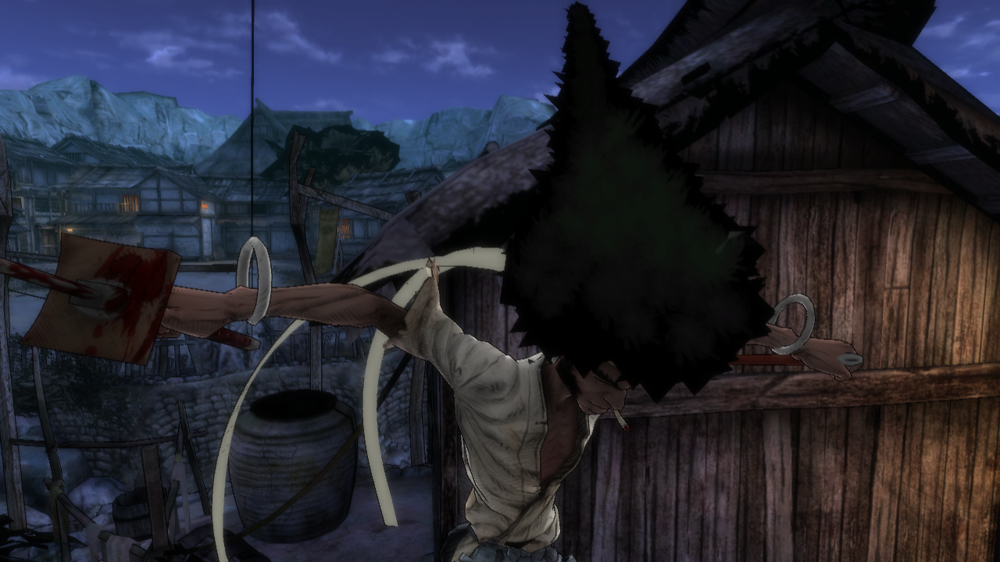
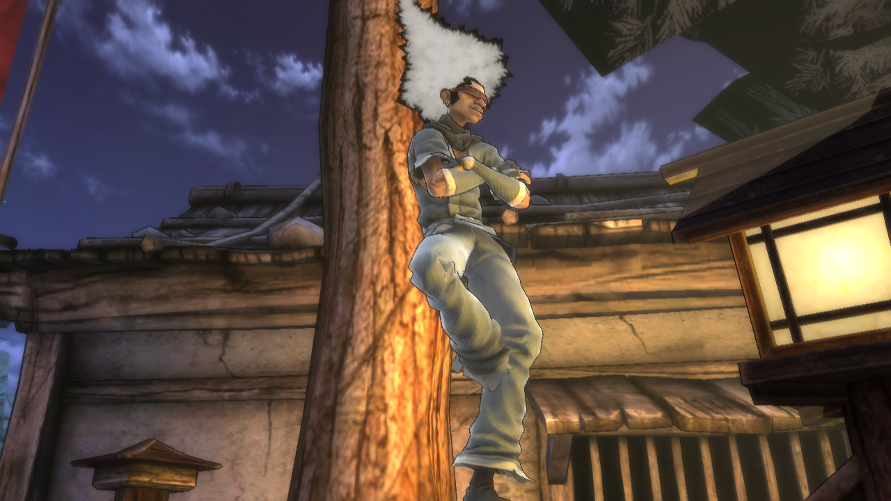
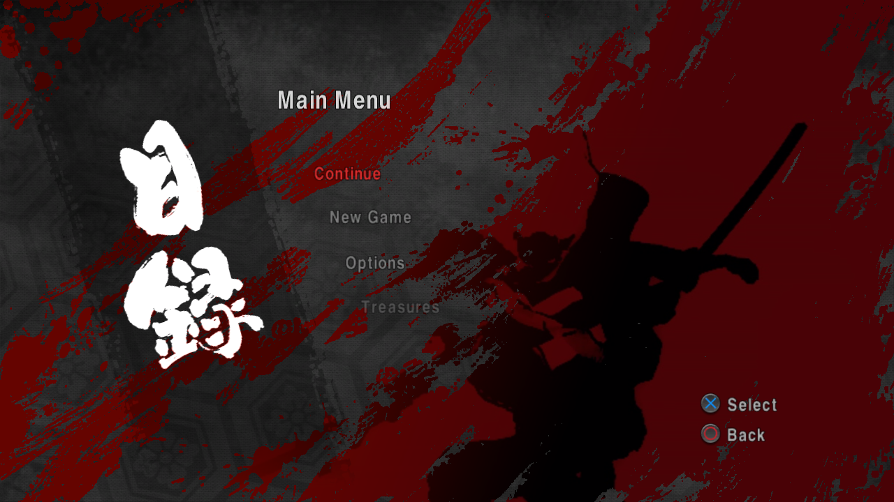
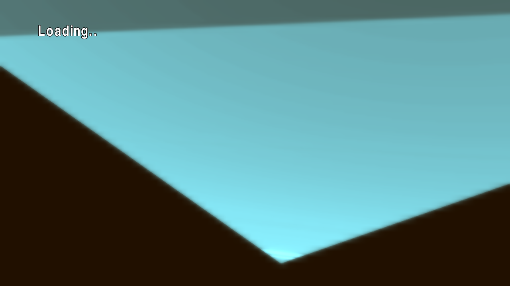

# Afro Samurai — static recompilation for PC (macOS)

🌐 **English** · [Português (BR)](README.pt-BR.md)

A native port of **Afro Samurai** (PS3, disc `BLUS30264`, v01.00) to
**macOS/arm64**, built with static recompilation: the game's PowerPC and SPU
code is translated to C/C++ and compiled into a native executable, with
graphics on Metal. It is not an emulator.

**It reaches gameplay, and the game renders correctly.** From the boot
through the logo movies, the main menu and New Game (or Continue), the first
level plays in a window with a controller: Afro, Ninja Ninja and the village
are drawn textured and lit, and the opening cutscene and the combat tutorial
run. It has been played in a window without a crash and runs at 30 frames a
second like the PS3, and the in-game audio now sounds right. See
[Status](#status).

| | |
| --- | --- |
| [](docs/screenshots/03-gameplay-village.png)<br>Gameplay: Afro in the village | [](docs/screenshots/04-ninja-ninja.png)<br>Ninja Ninja |
| [](docs/screenshots/01-main-menu.png)<br>The main menu | [](docs/screenshots/02-loading.png)<br>New Game: the loading screen |

The code is at [github.com/erikomis/afro-samurai-recomp](https://github.com/erikomis/afro-samurai-recomp); problems and
reports go to its [issues](https://github.com/erikomis/afro-samurai-recomp/issues).

Built on [ps3recomp](https://github.com/sp00nznet/ps3recomp), with the layout
and the tools of the author's other ports
([inFAMOUS 2](https://github.com/erikomis/infamous2-recomp),
[Resistance: Fall of Man](https://github.com/erikomis/resistance-recomp),
[Resistance 2](https://github.com/erikomis/resistance2-recomp)).

> [!WARNING]
> **Early work in progress.** The first level is playable, but only its
> start has been played, and the grass and foliage textures still await a
> final visual check. There are no releases: you build the game yourself from your own
> disc. Apple-silicon macOS only. What is missing is in
> [ROADMAP.md](ROADMAP.md).

> **This repository contains no game data, no firmware, no Sony keys and
> nothing translated from them.** Everyone generates all of that locally from
> their own legitimate copy. A fan project, not affiliated with Bandai Namco
> Entertainment, Sony Interactive Entertainment or GONZO.

## Status

As of 2026-11-07: boot → heaps and static constructors → SPURS and the
game's threads → the save is loaded → audio up → the logo and credit movies
(`bng.bik`, `two_headbands.bik`, `afro_credit.bik`) → the main menu over
`background_movie.bik` → New Game or Continue → the 3D loading screen → the
opening cutscene and the combat tutorial, rendered correctly, controlled
with a pad (Xbox Series X and DualSense through SDL). RPCS3 running the same
disc was the reference for what the scene should look like.

Since then (2026-11-11), the audio and the textures:

- **In-game audio (slow, smeared, unintelligible in windowed play), fixed.**
  A sample of the session showed the FMOD mixer SPU thread spending 84% of
  its time in the SPU interpreter: the mixer DMAs each of the 18 codec and
  DSP plugins (SPU images 2-19) from the EBOOT into a different local-store
  address than the one they were lifted at, so every call missed the lifted
  code and was interpreted, too slow for the mixer's 5.3 ms blocks.
  `tools/lift_fmod_plugins.sh` (run by `rebuild.sh spu`) now lifts them as
  relocatable overlays; the interpreter share dropped from 979 of 1162
  mixer-thread samples to none, with the same output level. Confirmed by ear.
  `SPU_RELOC_OFF=1` goes back to the interpreter (for comparison).
- **Alpha-to-coverage (grass and foliage cards drawn as dark rectangles).**
  The title cuts those cards out with alpha-to-coverage
  (`SET_ANTI_ALIASING_CONTROL`, `0x1D7C`), which the draw engine ignored.
  With no multisampled target it is now emulated as an alpha test at 0.5
  (`PS3RECOMP_ENG_A2C=0` ignores the register again).
- **2D blits wiping the 3D alpha-test state.** The title's NV3089
  scaled-image blits (subchannel 5) landed in the 3D register file because
  the draw engine stripped the subchannel, so every cut-out card after the
  first blit lost its alpha test. Only 3D subchannels now reach the engine
  (`GCM_ENGINE_3D_SUBCH=1`, set by the port): all 83 dumped draws in the
  village read the title's alpha test (it was garbage on 966 of 1178).

Later the same day, speed and housekeeping:

- **Frame rate in play: 26.1 -> 28.9 fps.** Over the same 60 s of a
  headless walk in the village, p95 went from 64 to 42 ms, p99 from 83 to
  57 ms, and frames over 50 ms from 12.4% to 2.0%. The vertex-skinning
  JOBLIST ran its jobs one after another on one host thread, 94% busy,
  and the render thread waited on it every frame; it now runs on four
  threads, as the SPURS job manager spreads a list over the SPUs
  (`SPURS_JC_JOBLIST_PAR=4`, set by the port). The FIFO drain also takes
  less CPU per draw (17.8 -> 14.3 ms a frame): a direct map for the vertex
  dedupe, a loop of its own for packed `CMP32` normals, and a four-lane
  texture hash.
- **Shader translations kept across runs.** `run.sh` exported a variable
  nothing reads, so every run translated each shader again; it now sets
  `PS3RECOMP_MSL_CACHE=cache/msl` (worst frame in the first minutes of play
  481 -> 261 ms).
- **Quitting.** Closing the window used to leave the game running with no
  window; it, Ctrl+C and SIGTERM now quit the way Cmd+Q and the console's
  Quit Game do (REQUEST_EXITGAME, then exit 0 after `PS3_QUIT_GRACE_MS`,
  never while a save is being written).
- **Long runs.** Ten minutes headless: memory steady at ~600 MB from the
  fourth minute on, no "unresolved indirect call".

The two fixes that took the game from exploded geometry to a correct scene
(2026-11-07):

- **JOBLIST in the SPURS job chains.** The renderer laps its skinning chain
  every frame as [JOB palette] → [JOBLIST of 5 vertex-skinning jobs] → [JOB
  lap notify]. The HLE chain walker treated JOBLIST as a no-op, so the
  skinning jobs never ran and about 100 colour draws a frame read another
  writer's leftovers from the RSX-visible ring: giant stretched triangles.
  The walker now runs a JOBLIST's jobs (`SPURS_JC_JOBLIST=0` skips it).
- **One job-context pointer per input.** Those skinning jobs take two DMA
  inputs, and the older job context they read lists one LS pointer per
  input and then per cache buffer; input 1 pointed at the cache, so the
  characters were skinned from the wrong data (shards in cutscenes).

Earlier the same day, the vertex programs' start slot: branch targets in RSX
vertex microcode are absolute, and decompiling every program as if it
started at slot 0 left branching programs looping 16,384 times per vertex
(0.4–3 s of GPU per frame).

What it took, with the cause of each:

- **Memory pools:** the game creates and destroys thousands of small
  `sys_mempool`s (about 3,800 in two minutes; 16-, 32- and 64-byte classes).
  `sysPrxForUser` now implements `try_allocate` / `allocate` / `free` /
  `destroy`, writes the counts big-endian, and hands out generation-tagged
  handles so a destroyed pool's handle is never reused by mistake
  (`SYS_MEMPOOL_LOG=1` traces it).
- **The memory mapper:** the game places its own 1 MB heap pages with
  `sys_mmapper_map_memory` next to those 256 KB pools. The untracked cursor
  overlapped the two (a block array was `memset` over live list nodes), then
  ran out of address space and the game called `abort()`. The mapper now
  keeps a page-owner map with real map / unmap / free and a next-fit search
  per reservation (`PS3_MMAPPER_TRACK=1`, on by default).
- **Six ascending reservations:** the game reserves 512 MB plus 5 × 256 MB
  of address space, and routes `free()` by which reservation range a pointer
  falls in, so they must come back in ascending order. Two came back
  `ENOMEM`. With `PS3_MAPPER_WIDE=1` (on by default) they ascend and may
  enclose the runtime's own windows, which the tracked mapper never hands out.
- **FMOD's SPU plugins:** the FMOD Ex mixer task loads its DSP and codec
  plugins as overlays and branches into them (LS `0x25A18`). With no lifted
  code there the job ended (they are lifted now, see the audio fix above), and FMOD's event thread then waited for good on
  the mixer's event flag while holding the lwmutex the main thread needed.
  `SPU_INTERP_UNLIFTED` (on by default) interprets what has no lifted body, as
  the Deadpool port does.
- **First save:** with no save yet, the game's stat callback answers
  `ERR_NODATA`; firmware turns that into `ERROR_CBRESULT`, which is how the
  game learns to create one. The toolkit answered `ERROR_NODATA`, and the game
  said its save data "appears to be damaged" and stopped.
  `SAVEDATA_CBRESULT_STRICT=1` (on by default) answers as firmware does; the
  game now writes and reads back `AFRO_0.SAV`.
- **`cellKbRead`:** the game polls the keyboard every frame through
  `cellKbRead` (NID `0xFF0A21B7`, the SDK's name for `cellKbGetData`). It was
  unresolved, the generic path answered `CELL_OK` without writing anything,
  and the game read whatever the stack held as key events.
- **SPURS lock-free queues:** `_cellSpursLFQueuePushBody` is implemented on
  the canonical 128-byte `CellSyncLFQueue` line the SPU consumer reads, and a
  task that parks in `WAIT_SIGNAL` while its queue already holds entries
  resumes instead of sleeping (both ported from the Resistance 2 tree;
  `SPURS_LFQ_NOWAKE=1` turns the second off).
- **The movies (black screen at boot):** the game opens each movie with
  `cellFsOpen` and hands the descriptor to Bink, which seeks and reads it
  with the raw lv2 syscalls (818/802). Those keep their own descriptor table
  and knew nothing of a `cellFs` one, so every movie failed to open and the
  boot sat on black frames after `bng.bik`. lv2 read, lseek and fstat now fall
  back to the `cellFs` table.
- **The skinning job chain (frozen after New Game):** the render thread
  waits for an event from the NTG SPU skinning chain, and nothing walked it.
  The job binaries are raw blobs, not SPU ELFs, so they were never lifted
  ("dispatch MISS"); `tools/lift_jobs.sh` lifts them. The chain is kicked at
  boot and sits on its guard until a game starts, and the walker's 20 s
  give-up ended it (`SPURS_JG_WAIT_FOREVER=1`). The ring's last job sends the
  one event per lap the render thread waits for, on a queue of depth 1, and
  a synthetic event per job filled it first (`SPURS_JC_EVENT_FROM_JOB=1`).
  And the job reads its buffer counts and DMA tag past the 48-byte job
  context (an older layout); unset, it halted on its own guard, or PUT its
  whole local store over the game's code at `0x10000`
  (`SPURS_JOB_CTX_V1=1`). A DMA PUT into the executable's read-only segment
  is now dropped, as it faults on hardware.
- **Jump tables (New Game spinning on a NULL):** the lifter resolves a
  `switch` only over the cases inside the function it lifted, and cases past
  where it cut a large function went through the indirect-call fallback,
  which needs a lifted function at the case address. The engine's message
  dispatcher (`func_001EA288`, 4,191 cases) lost case `0x1F079C` that way.
  `tools/augment_functions.py` splits the function list at every case target
  of the tables in `tools/jumptables.txt` before lifting.

Known issues, being worked on:

- **The grass in the courtyard is not yet confirmed by eye.** The two
  texture fixes above were checked in headless runs (alpha registers read
  right on all 83 dumped draws; grass renders as blades in the cutscene),
  but the final look at the courtyard grass in a windowed session is
  pending. Other broken textures may remain and have not been reported yet:
  please open an [issue](https://github.com/erikomis/afro-samurai-recomp/issues) with a screenshot.
- **Streamed textures** may be stale: the texture cache hashes the full
  texture only every 8 frames, which is suspected (not confirmed) for
  textures that stream in; `PS3RECOMP_ENG_TEXHASH_FULL=1` tests it.
- **Only the start of the first level has been played**; the rest of the
  game is untested.
- **Frame pacing** is not yet even: 2% of frames in play still take
  over 50 ms (the FIFO drain and the skinning jobs are the next costs).
- **Keyboard and mouse** have not been tested; a controller works.
- One headless run stalled once while loading the level (after
  `LoadRenderThreadProc` exited); not reproduced since, not investigated.

## How it works

1. **Decrypt** your disc's `EBOOT.BIN` (a disc SELF, `key_rev 0x0001`, type
   APP) into `game/EBOOT.elf` with `tools/decrypt_self.py` and your own key
   file. RPCS3 is not needed.
2. **Analyse and lift** it with the toolkit's `ppu_loader.py` and
   `ppu_lifter.py`: 12,869 functions in the OPD table, 32,951 emitted by the
   lifter, as C++ in `recompiled/BLUS30264/` (16 translation units). Before
   lifting, `tools/augment_functions.py` adds the case targets of the jump
   tables in `tools/jumptables.txt` to the function list.
3. **SPU code:** the 20 SPU ELFs embedded in the EBOOT are cut out by the
   toolkit's `extract_spu_images.py` and lifted by `tools/lift_spu.sh` into
   `port/spu/`: EDGE ZLIB inflate (`spu_0000`), the FMOD Ex SPURS mixer
   (`spu_0001`, lifted with every call's return as an entry, so the plugins
   return into lifted code) and 18 FMOD codec and DSP plugins
   (`spu_0002`–`spu_0019`). The SPURS job binaries of the skinning chain are
   not ELFs: `tools/extract_jobs.py` extracts them from the EBOOT and
   `tools/lift_jobs.sh` lifts them (the 17,552-byte skinning job `8B2B4776E3A079D8` and the
   112-byte job beside it, `37DA975A7C220171`).
4. **Build** with CMake/Ninja against the toolkit: the runtime (LV2
   syscalls, HLE firmware libraries, SPURS, the Metal RSX backend) plus the
   lifted code, into `build/BLUS30264/AfroSamuraiRecomp`.

The game is Namco Bandai's own **NTG** engine (paths `nhi/ntg/...`), not
Unreal Engine 3: scripts and configuration in `.ini` and `.ntg` files inside
`ps3.psarc` (2.7 GB, all of the game's content), Bink movies, FMOD Ex audio,
NavPower for AI navigation and EDGE 1.2.3.0. It has no PRX of its own and
imports 156 firmware functions from 12 libraries; it saves through
`cellSaveData` and keeps a cache in `/dev_hdd0/game/ntg_cache` and
`/dev_hdd1`. The full inventory is in
[`docs/game-manifest.md`](docs/game-manifest.md).

The toolkit is upstream ps3recomp **v0.19.0** (`ae92407b`) plus this port's
changes (the memory pools, the tracked mapper, the first-save answer,
`cellKbRead`, the SPURS lock-free queue), which are generic and env-gated,
kept as one patch:
[`patches/ps3recomp-ae92407b-afro.patch`](patches/). `tools/setup_toolkit.sh`
clones upstream, checks out `ae92407b` and applies it next to this repository
(`../ps3recomp-afro`); `tools/export_toolkit_patch.sh` writes a changed
checkout back into the patch.

## Building from source

### What you need

- An Apple-silicon Mac (macOS with Metal). Each lifted chunk is tens of MB
  of C++ and clang takes 3–4 GB on one; `tools/build.sh` keeps the build to
  two compiles at a time and watches memory and disk.
- Your own **Afro Samurai disc, `BLUS30264`**, dumped to an ISO. Put it
  (or a link to its folder) at `game_iso/`; it is mounted read-only and never
  written to.
- Xcode Command Line Tools and Homebrew:

```sh
brew install cmake ninja sdl2 glslang spirv-cross spirv-tools ffmpeg python@3.12
```

### Setting up

```sh
git clone https://github.com/erikomis/afro-samurai-recomp.git
cd afro-samurai-recomp
tools/setup.sh              # toolkit, Python venv, keys; no build
tools/setup.sh --check      # only validate
```

`tools/setup.sh` puts the ps3recomp toolkit at `../ps3recomp-afro`
(`PS3RECOMP_DIR` changes it) with `tools/setup_toolkit.sh`, makes this
repository's Python venv (`.venv`, from `python3.12`; `PYBIN` picks another)
with the toolkit's `requirements.txt`, and writes the disc SELF key file with
`tools/fetch_keys.py`. The keys come from RPCS3's public `key_vault.cpp` at a
pinned commit, checked by its SHA-256 (`--keys-source FILE` takes the file
from disk instead); no key is in this repository. The file goes to
`~/Library/Application Support/afro-samurai-recomp/keys/self_keys.txt`,
mode 600 (`AFRO_KEYS` puts it elsewhere).

### Building

```sh
tools/rebuild.sh            # stage, decrypt, analyse, lift, spu, build
```

`tools/rebuild.sh` runs these steps (run any of them alone by name, e.g.
`tools/rebuild.sh spu build`):

| Step | What it does |
| --- | --- |
| `stage` | mounts the ISO read-only (`tools/mount.sh`) and copies `EBOOT.BIN` and `PARAM.SFO` into `game/` |
| `decrypt` | `tools/decrypt_self.py` with `$AFRO_KEYS` → `game/EBOOT.elf` |
| `analyse` | `ppu_loader.py` → `analysis/BLUS30264/` |
| `lift` | `ppu_lifter.py` → `recompiled/BLUS30264/` (`CHUNKS`, default 12; `JOBS` limits parallelism) |
| `spu` | `extract_spu_images.py` and `tools/lift_spu.sh` → `port/spu/` |
| `build` | CMake (once) + `tools/build.sh` → `build/BLUS30264/AfroSamuraiRecomp` |

The `spu` step also extracts the two known raw skinning-chain jobs directly
from the decrypted EBOOT, validates their SHA-256 and runtime fingerprints,
and lifts them. No capture run is needed. To run this alone, use
`tools/lift_jobs.sh`. Additional jobs can still be captured with `SPU_DUMP_MISS`.

The first build compiles a lot of generated code and takes a while. Always
build through `tools/build.sh`: it refuses to start while another Ninja is
running (also another port's), stops if memory runs low (exit 99) and asks
for `BUILD_ALLOW_FULL=1` before rebuilding many lifted chunks at once
(`tools/build.sh --check` says what would be rebuilt; `BUILD_JOBS` sets the
parallel compiles, default 2). The tools run in the venv `tools/setup.sh`
makes (`PY=<python>` picks another, Python 3.10 or newer). Paths are in [`tools/env.sh`](tools/env.sh).

## Playing

The story plays from New Game into the first level (see the status above). To run it:

```sh
tools/run.sh
```

It mounts the ISO, links the disc's `PS3_GAME` into the VFS root and keeps
`/dev_hdd0` and `/dev_hdd1` in this repository's own `rpcs3/` folder, never
in RPCS3's install, so a test run cannot touch your RPCS3 saves. Extra
arguments are environment overrides: `tools/run.sh PS3_VERBOSE=1`.

### Environment

| Variable | Effect |
| --- | --- |
| `PS3RECOMP_DIR` | the toolkit checkout (default `../ps3recomp-afro`) |
| `AFRO_KEYS` | the key file `fetch_keys.py` writes and `decrypt_self.py` reads |
| `AFRO_VENV`, `PY` | the Python venv (`.venv`) and its interpreter |
| `AFRO_ISO_DIR`, `AFRO_MOUNT` | where the ISO is (`game_iso/`) and where it is mounted (`/Volumes/AFRO_SAMURAI`) |
| `PS3_HDD0_ROOT`, `PS3_HDD1_ROOT` | the game's HDD folders (`rpcs3/dev_hdd0`, `rpcs3/dev_hdd1`) |
| `PS3_VERBOSE=1` | the full runtime log (off in `run.sh`) |
| `PS3_QOS=0` | leaves macOS's default thread priority (by default the game's threads run as user-interactive, off the efficiency cores) |
| `PS3_MMAPPER_TRACK=0` | the memory mapper back to the untracked cursor (brings back the `abort()`) |
| `PS3_MAPPER_WIDE=0` | the six reservations back to the narrow window (two `ENOMEM`) |
| `PS3_MMAPPER_FIRSTFIT=1` / `PS3_MMAPPER_ZERO=1` | first-fit instead of next-fit (measured worse) / zero pages on map |
| `SAVEDATA_CBRESULT_STRICT=0` | `ERR_NODATA` back to `ERROR_NODATA` (the "damaged save" stop) |
| `SPU_INTERP_UNLIFTED` | interpret SPU code with no lifted body (set by `port/main.cpp`; no off switch yet) |
| `SPU_RELOC_OFF=1` | leaves FMOD's 18 plugin overlays to the SPU interpreter (A/B for the audio fix) |
| `PS3RECOMP_ENG_A2C=0` | ignores alpha-to-coverage (`0x1D7C`) again, so cut-out cards draw whole |
| `GCM_ENGINE_3D_SUBCH=0` | 2D blit methods reach the 3D register file again (grass loses its alpha test; the port sets it to 1) |
| `PS3RECOMP_ENG_TEXHASH_FULL=1` | hashes whole textures every frame, to test stale streamed textures (unconfirmed) |
| `PS3_AUDIO_DOWNMIX=itu` | optional stereo fold-down of the multichannel mix (off by default) |
| `SPURS_JC_JOBLIST_PAR=<n>` | runs a JOBLIST's jobs on up to n host threads (the port sets 4; 0 = one after another) |
| `PS3RECOMP_VTX_REMAP_HASH=1` | the vertex dedupe uses its hash for every draw again (A/B) |
| `PS3RECOMP_MSL_CACHE=<dir>` | where the shader translations are kept (`run.sh`: `cache/msl`) |
| `PS3_QUIT_GRACE_MS` | how long a quit waits for the game before ending it (default 3000) |
| `SPURS_LFQ_NOWAKE=1` | turns off the LF-queue wake fix (for comparison) |
| `SPURS_JG_WAIT_FOREVER=0` | the job-chain walker gives up on a closed guard after 20 s again (the skinning chain dies before New Game) |
| `SPURS_JC_EVENT_FROM_JOB=0` | a synthetic event per job again (the render thread's event is dropped) |
| `SPURS_JOB_CTX_V1` | fills the older job-context fields the skinning job reads (set by `port/main.cpp`; no off switch yet) |
| `SPU_DUMP_MISS=<dir>` | writes every SPU job binary with no lifted code to `<dir>` (for `tools/lift_jobs.sh`) |
| `SYS_MEMPOOL_LOG=1`, `PS3_MEMTRACE=1`, `PS3_LFQ_LOG=<n>` | trace mempools / address reservations / the first n LF-queue pushes |
| `AFRO_TEXT_RO=1` | makes the game's code read-only after load, so a host write into it (an HLE copy, an SPU DMA, a file read) stops with its caller; `AFRO_TEXT_RO_CONT=1` reports each writer once and goes on |
| `AFRO_WRAP=<program>` | runs the game under a wrapper (a debugger script) |

The seven defaults above (`PS3_MMAPPER_TRACK`, `PS3_MAPPER_WIDE`,
`SPU_INTERP_UNLIFTED`, `SAVEDATA_CBRESULT_STRICT` and the three `SPURS_*`
job switches) are set in `afro_defaults()` in
[`port/main.cpp`](port/main.cpp) unless they are already in the environment;
so are `GCM_ENGINE_3D_SUBCH=1` and `SPURS_JC_JOBLIST_PAR=4`.

### Diagnostics

`tools/probe.sh <label> <seconds> [VAR=value ...]` runs the build headless
with a time limit and writes `cache/probe/<label>.log` and a frame dump,
`<label>.ppm`, every 120 presents. `PROBE_SNAP=<s>` keeps a copy of the
latest dump every `s` seconds, so a run shows a sequence rather than its last
frame. Buttons come from a script, `PAD_SCRIPT="<sec>:<mask>,..."` (START
`0x0008`, UP `0x0010`, DOWN `0x0040`, CROSS `0x4000`, CIRCLE `0x2000`, SQUARE
`0x8000`, TRIANGLE `0x1000`; `PAD_CLOCK=flips` counts flips instead of
seconds). It stops only the process it started.

```sh
PROBE_SNAP=5 tools/probe.sh boot 80
```

Into New Game, as tested (START every second from 85 to 100 s through the
movies and the title, then CROSS every 2 s from 101 to 145 s through the
menu; the timing can miss, run it again if it does):

```sh
B=""; for t in $(seq 85 100); do B="$B$t:0x0008,"; done
for t in $(seq 101 2 145); do B="$B$t:0x4000,"; done
PROBE_SNAP=10 tools/probe.sh newgame 240 PAD_SCRIPT="${B%,}" SPU_DUMP_MISS=$PWD/cache/jobs
```

Frame times: `PS3_FTRACE=<start s>:<seconds>:<file>` records a timeline
(the toolkit's `include/ps3emu/ps3_ftrace.h`), and
`tools/frametimes.py <file> [--kind flip|present]` prints the frame rate,
p50/p95/p99/max and the share of frames over 1.5x and 2x a 30 fps frame;
the toolkit's `tools/ftrace_report.py` says what each thread did per frame.

For a headless run through the menus, point `PS3_HDD0_ROOT=<empty dir>` at a
fresh folder: an existing save adds "Continue" to the menu and breaks the
scripted pad.

A debugger does not launch the game cleanly; attaching `lldb` to the
running process does, and guest memory is read through the `vm_base` symbol
(big-endian).

## Layout

| Path | What it is |
| --- | --- |
| [`port/`](port/) | The port: `main.cpp` (boot, guest thread, `afro_defaults()`), `stubs.cpp` (PRX hook and overrides, empty for now), `CMakeLists.txt`, `spu/` (written by `tools/lift_spu.sh`: the lifted SPU code and `spu_workloads.c`, never committed) |
| [`tools/`](tools/) | `setup.sh`, `setup_toolkit.sh`, `export_toolkit_patch.sh`, `fetch_keys.py`, `frametimes.py`, `rebuild.sh`, `build.sh`, `run.sh`, `probe.sh`, `mount.sh`, `env.sh`, `decrypt_self.py`, `lift_fmod_plugins.sh`, `lift_spu.sh`, `lift_jobs.sh`, `augment_functions.py` and `jumptables.txt` (the jump tables whose cases are lifted as functions) |
| [`docs/`](docs/) | `game-manifest.md`: the disc, the executable, the engine, the imports and the SPU images; `screenshots/` |
| [`patches/`](patches/) | The toolkit patch over ps3recomp v0.19.0 (`ae92407b`) |
| [`ROADMAP.md`](ROADMAP.md) | Status and next steps |
| [`CREDITS.md`](CREDITS.md) | Who this port builds on |
| `afro_samurai_ps3_recomp_enhanced.md` | The original plan (Portuguese), with the Enhanced Edition ideas |

`game/`, `analysis/`, `recompiled/`, `build/`, `cache/` and `rpcs3/` are
generated from your disc and never committed.

## License

Code in this repository: MIT ([LICENSE](LICENSE)). The toolkit is MIT by its authors. Afro
Samurai © Bandai Namco Entertainment, published by Namco Bandai Games and
based on the work of Takashi Okazaki and GONZO. This project is not
affiliated with any of them.
