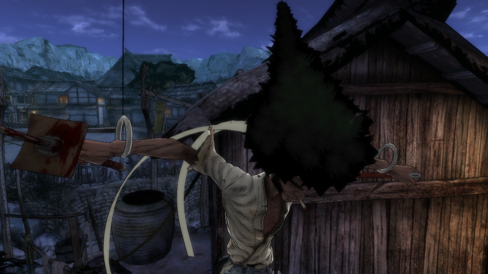
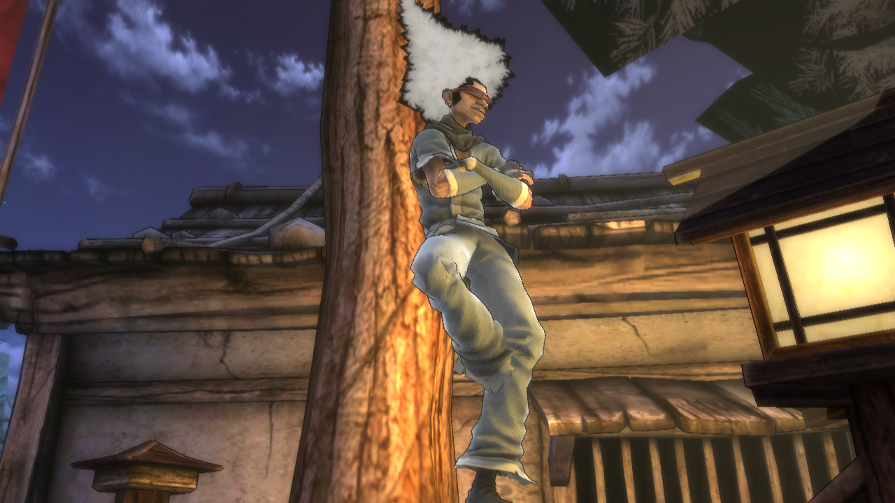
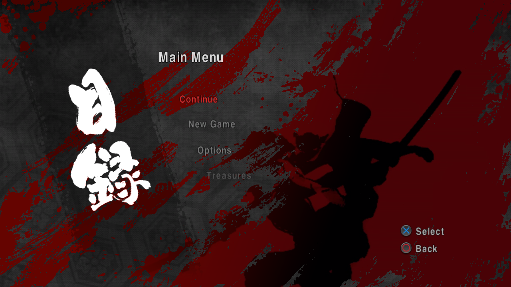
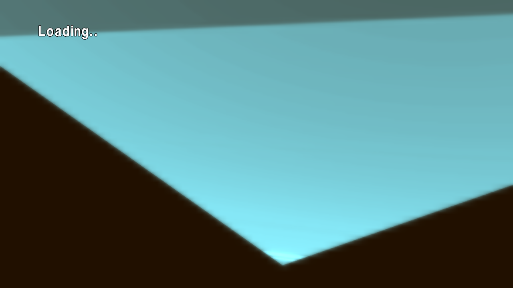

# Afro Samurai — recompilação estática para PC (macOS)

🌐 [English](README.md) · **Português (BR)**

Port nativo do **Afro Samurai** (PS3, disco `BLUS30264`, v01.00) para
**macOS/arm64**, feito com recompilação estática: o código PowerPC e SPU do
jogo é traduzido para C/C++ e compilado como um executável nativo, com
gráficos em Metal. Não é um emulador.

**Ele chega à gameplay, e o jogo é desenhado corretamente.** Do boot,
pelos vídeos de logo, pelo menu principal e pelo New Game (ou Continue), a
primeira fase roda numa janela com controle: o Afro, o Ninja Ninja e a vila
aparecem com textura e iluminação, e a cutscene de abertura e o tutorial de
combate rodam. Já foi jogado numa janela sem crash e roda a 30 quadros por
segundo como o PS3, e o áudio dentro do jogo agora soa certo. Veja
[Estado](#estado).

| | |
| --- | --- |
| [](docs/screenshots/03-gameplay-village.png)<br>Gameplay: o Afro na vila | [](docs/screenshots/04-ninja-ninja.png)<br>Ninja Ninja |
| [](docs/screenshots/01-main-menu.png)<br>O menu principal | [](docs/screenshots/02-loading.png)<br>New Game: a tela de carregamento |

O código está em [github.com/erikomis/afro-samurai-recomp](https://github.com/erikomis/afro-samurai-recomp); problemas e
relatos vão para as [issues](https://github.com/erikomis/afro-samurai-recomp/issues).

Construído sobre o [ps3recomp](https://github.com/sp00nznet/ps3recomp), com a
organização e as ferramentas dos outros ports do mesmo autor
([inFAMOUS 2](https://github.com/erikomis/infamous2-recomp),
[Resistance: Fall of Man](https://github.com/erikomis/resistance-recomp),
[Resistance 2](https://github.com/erikomis/resistance2-recomp)).

> [!WARNING]
> **Trabalho em andamento, no começo.** A primeira fase é jogável, mas só o
> começo dela foi jogado, e as texturas de grama e folhagem ainda aguardam a
> conferência visual final. Não há releases: você mesmo compila o jogo a partir do seu
> disco. Só macOS com Apple silicon. O que falta está no
> [ROADMAP.pt-BR.md](ROADMAP.pt-BR.md).

> **Este repositório não contém dados do jogo, firmware, chaves da Sony nem
> nada traduzido a partir deles.** Cada um gera tudo isso localmente a partir
> da própria cópia legítima. Projeto de fã, sem afiliação com a Bandai Namco
> Entertainment, a Sony Interactive Entertainment ou a GONZO.

## Estado

Em 07/11/2026: boot → heaps e construtores estáticos → SPURS e as threads do
jogo → o save é carregado → áudio ligado → os vídeos de logo e de créditos
(`bng.bik`, `two_headbands.bik`, `afro_credit.bik`) → o menu principal sobre
o `background_movie.bik` → New Game ou Continue → a tela 3D de carregamento →
a cutscene de abertura e o tutorial de combate, desenhados corretamente, com
controle (Xbox Series X e DualSense pelo SDL). O RPCS3 rodando o mesmo disco
foi a referência de como a cena deve ficar.

As duas correções que levaram o jogo da geometria explodida a uma cena
correta (07/11/2026):

- **JOBLIST nas cadeias de jobs do SPURS.** O renderizador roda sua cadeia
  de skinning a cada quadro como [JOB paleta] → [JOBLIST de 5 jobs de
  skinning de vértices] → [JOB aviso de volta]. O percorredor HLE tratava o
  JOBLIST como nada, então os jobs de skinning nunca rodavam e uns 100 draws
  de cor por quadro liam sobras de outro escritor no anel visível ao RSX:
  triângulos gigantes esticados. Agora o percorredor roda os jobs de um
  JOBLIST (`SPURS_JC_JOBLIST=0` pula de novo).
- **Um ponteiro do contexto de job por entrada.** Esses jobs de skinning têm
  duas entradas de DMA, e o contexto de job antigo que eles leem lista um
  ponteiro de LS por entrada e depois um por buffer de cache; a entrada 1
  apontava para o cache, então os personagens eram deformados a partir dos
  dados errados (cacos nas cutscenes).

Depois disso (11/11/2026), o áudio e as texturas:

- **Áudio dentro do jogo (lento, borrado, ininteligível em jogo em janela),
  corrigido.** Uma amostra da sessão mostrou a thread SPU do mixer do FMOD
  gastando 84% do tempo no interpretador de SPU: o mixer copia cada um dos
  18 plugins de codec e DSP (imagens SPU 2-19) do EBOOT para um endereço de
  local store diferente daquele em que foram traduzidos, então toda chamada
  perdia o código traduzido e era interpretada, devagar demais para os
  blocos de 5,3 ms do mixer. O `tools/lift_fmod_plugins.sh` (rodado pelo
  `rebuild.sh spu`) agora os traduz como overlays relocáveis; a parte do
  interpretador caiu de 979 de 1162 amostras da thread do mixer para
  nenhuma, com o mesmo nível de saída. Confirmado de ouvido.
  `SPU_RELOC_OFF=1` volta ao interpretador (para comparação).
- **Alpha-to-coverage (cartões de grama e folhagem desenhados como
  retângulos escuros).** O título recorta esses cartões com
  alpha-to-coverage (`SET_ANTI_ALIASING_CONTROL`, `0x1D7C`), que o motor de
  desenho ignorava. Sem alvo multisampled, agora é emulado como um alpha
  test em 0,5 (`PS3RECOMP_ENG_A2C=0` volta a ignorar o registrador).
- **Blits 2D apagando o estado de alpha test do 3D.** Os blits de imagem
  escalada NV3089 do título (subcanal 5) caíam no arquivo de registradores
  3D porque o motor de desenho removia o subcanal, então todo cartão
  recortado depois do primeiro blit perdia o alpha test. Agora só os
  subcanais 3D chegam ao motor (`GCM_ENGINE_3D_SUBCH=1`, definida pelo
  port): os 83 draws despejados na vila leem o alpha test do título (antes
  era lixo em 966 de 1178).

Mais tarde no mesmo dia, velocidade e arrumação:

- **Taxa de quadros no jogo: 26,1 -> 28,9 fps.** Nos mesmos 60 s de uma
  caminhada headless na vila, o p95 foi de 64 para 42 ms, o p99 de 83 para
  57 ms, e os quadros acima de 50 ms de 12,4% para 2,0%. A JOBLIST de
  skinning de vértices rodava os jobs um depois do outro num único thread,
  94% ocupado, e o thread de render esperava por ela a cada quadro; agora
  ela roda em quatro threads, como o gerenciador de jobs do SPURS espalha
  uma lista pelas SPUs (`SPURS_JC_JOBLIST_PAR=4`, definida pelo port). A
  drenagem da FIFO também gasta menos CPU por draw (17,8 -> 14,3 ms por
  quadro): mapa direto na deduplicação de vértices, laço próprio para as
  normais compactadas `CMP32` e hash de textura em quatro faixas.
- **Traduções de shader guardadas entre execuções.** O `run.sh` exportava
  uma variável que nada lê, então cada execução traduzia cada shader de
  novo; agora ele define `PS3RECOMP_MSL_CACHE=cache/msl` (pior quadro nos
  primeiros minutos de jogo 481 -> 261 ms).
- **Sair do jogo.** Fechar a janela deixava o jogo rodando sem janela;
  agora fechar, Ctrl+C e SIGTERM saem como o Cmd+Q e o Quit Game do console
  (REQUEST_EXITGAME, depois exit 0 após `PS3_QUIT_GRACE_MS`, nunca com um
  save sendo gravado).
- **Sessões longas.** Dez minutos headless: memória estável em ~600 MB do
  quarto minuto em diante, nenhum "unresolved indirect call".

Antes, no mesmo dia, o slot inicial dos vertex programs: os destinos de
salto no microcódigo de vértice do RSX são absolutos, e traduzir todo
programa como se começasse no slot 0 deixava os programas com salto rodando
16.384 vezes por vértice (0,4–3 s de GPU por quadro).

O que foi preciso, com a causa de cada um:

- **Pools de memória:** o jogo cria e destrói milhares de `sys_mempool`
  pequenos (uns 3.800 em dois minutos; classes de 16, 32 e 64 bytes). O
  `sysPrxForUser` agora implementa `try_allocate` / `allocate` / `free` /
  `destroy`, escreve as contagens em big-endian e entrega handles marcados com
  geração, para que o handle de um pool destruído nunca seja reaproveitado por
  engano (`SYS_MEMPOOL_LOG=1` rastreia).
- **O mapeador de memória:** o jogo coloca as próprias páginas de heap de
  1 MB com `sys_mmapper_map_memory` ao lado desses pools de 256 KB. O cursor
  sem controle sobrepunha os dois (um array de blocos levava `memset` por
  cima de nós de lista vivos), depois ficava sem espaço de endereços e o jogo
  chamava `abort()`. O mapeador agora mantém um mapa de dono por página, com
  map / unmap / free de verdade e busca next-fit por reserva
  (`PS3_MMAPPER_TRACK=1`, ligado por padrão).
- **Seis reservas em ordem crescente:** o jogo reserva 512 MB mais
  5 × 256 MB de espaço de endereços e decide o `free()` pela faixa de reserva
  em que o ponteiro cai, então elas precisam vir em ordem crescente. Duas
  voltavam `ENOMEM`. Com `PS3_MAPPER_WIDE=1` (ligado por padrão) elas sobem
  e podem englobar as janelas do próprio runtime, que o mapeador com controle
  nunca entrega.
- **Os plugins SPU do FMOD:** a tarefa do mixer do FMOD Ex carrega seus
  plugins de DSP e codec como overlays e pula para dentro deles (LS
  `0x25A18`). Sem código traduzido ali o job terminava, e a thread de eventos
  do FMOD esperava para sempre pela event flag do mixer segurando o lwmutex
  de que a thread principal precisava (hoje eles são traduzidos, veja a
  correção do áudio acima). `SPU_INTERP_UNLIFTED` (ligado por
  padrão) interpreta o que não tem corpo traduzido, como no port do Deadpool.
- **Primeiro save:** sem save ainda, o callback de stat do jogo responde
  `ERR_NODATA`; o firmware transforma isso em `ERROR_CBRESULT`, que é como o
  jogo sabe que deve criar um. O toolkit respondia `ERROR_NODATA`, e o jogo
  dizia que os dados salvos "parecem estar danificados" e parava.
  `SAVEDATA_CBRESULT_STRICT=1` (ligado por padrão) responde como o firmware;
  agora o jogo grava e lê de volta o `AFRO_0.SAV`.
- **`cellKbRead`:** o jogo consulta o teclado a cada quadro por
  `cellKbRead` (NID `0xFF0A21B7`, o nome do SDK para `cellKbGetData`). Não
  estava resolvido, o caminho genérico respondia `CELL_OK` sem escrever nada,
  e o jogo lia o que estivesse na pilha como eventos de tecla.
- **Filas lock-free do SPURS:** `_cellSpursLFQueuePushBody` foi
  implementado sobre a linha canônica de 128 bytes da `CellSyncLFQueue` que o
  consumidor SPU lê, e uma tarefa que estaciona em `WAIT_SIGNAL` com a fila já
  tendo entradas continua em vez de dormir (os dois trazidos da árvore do
  Resistance 2; `SPURS_LFQ_NOWAKE=1` desliga o segundo).
- **Os vídeos (tela preta no boot):** o jogo abre cada vídeo com
  `cellFsOpen` e entrega o descritor ao Bink, que faz seek e lê com as
  syscalls cruas do lv2 (818/802). Elas têm a própria tabela de descritores e
  não sabiam nada de um descritor do `cellFs`, então todo vídeo falhava ao
  abrir e o boot ficava em quadros pretos depois do `bng.bik`. Agora read,
  lseek e fstat do lv2 recorrem à tabela do `cellFs`.
- **A cadeia de jobs de skinning (congelado depois do New Game):** a thread
  de render espera um evento da cadeia de skinning em SPU do NTG, e ninguém a
  percorria. Os binários dos jobs são blobs crus, não ELFs SPU, então nunca
  eram traduzidos ("dispatch MISS"); o `tools/lift_jobs.sh` traduz. A cadeia é
  disparada no boot e fica parada no guard até começar um jogo, e o
  desistir-depois-de-20-s do percorredor a encerrava
  (`SPURS_JG_WAIT_FOREVER=1`). O último job do anel manda o único evento por
  volta que a thread de render espera, numa fila de profundidade 1, e um
  evento sintético por job a enchia antes (`SPURS_JC_EVENT_FROM_JOB=1`). E o
  job lê a contagem de buffers e a tag de DMA além dos 48 bytes do contexto
  de job (um layout mais antigo); sem eles, parava no próprio guard ou fazia
  PUT de todo o local store por cima do código do jogo em `0x10000`
  (`SPURS_JOB_CTX_V1=1`). Um PUT de DMA no segmento só-leitura do executável
  agora é descartado, como dá falha no hardware.
- **Tabelas de salto (New Game girando num NULL):** o lifter resolve um
  `switch` só com os casos que estão dentro da função que ele traduziu, e os
  casos depois do ponto onde ele cortou uma função grande iam pelo fallback
  de chamada indireta, que precisa de uma função traduzida no endereço do
  caso. O despachante de mensagens do motor (`func_001EA288`, 4.191 casos)
  perdia o caso `0x1F079C` assim. O `tools/augment_functions.py` divide a
  lista de funções em cada alvo das tabelas do `tools/jumptables.txt` antes
  de traduzir.

Problemas conhecidos, sendo resolvidos:

- **A grama do pátio ainda não foi confirmada a olho.** As duas correções
  de textura acima foram conferidas em testes headless (os registradores de
  alpha saem certos nos 83 draws despejados; a grama aparece como lâminas na
  cutscene), mas a conferência final da grama do pátio numa sessão em janela
  está pendente. Outras texturas quebradas podem restar e ainda não foram
  reportadas: abra uma [issue](https://github.com/erikomis/afro-samurai-recomp/issues) com uma captura de tela.
- **Texturas em streaming** podem ficar desatualizadas: o cache de texturas
  só calcula o hash da textura inteira a cada 8 quadros, o que é suspeito
  (não confirmado) para texturas que chegam por streaming;
  `PS3RECOMP_ENG_TEXHASH_FULL=1` testa isso.
- **Só o começo da primeira fase foi jogado**; o resto do jogo não foi
  testado.
- **O ritmo dos quadros** ainda não é uniforme: 2% dos quadros no jogo
  ainda passam de 50 ms (a drenagem da FIFO e os jobs de skinning são os
  próximos custos).
- **Teclado e mouse** não foram testados; o controle funciona.
- Um teste headless parou uma vez enquanto carregava a fase (depois que o
  `LoadRenderThreadProc` terminou); não se repetiu, não foi investigado.

## Como funciona

1. **Descriptografar** o `EBOOT.BIN` do seu disco (um SELF de disco,
   `key_rev 0x0001`, tipo APP) em `game/EBOOT.elf` com o
   `tools/decrypt_self.py` e o seu próprio arquivo de chaves. Não precisa do
   RPCS3.
2. **Analisar e traduzir** com o `ppu_loader.py` e o `ppu_lifter.py` do
   toolkit: 12.869 funções na tabela OPD, 32.951 emitidas pelo lifter, como
   C++ em `recompiled/BLUS30264/` (16 unidades de tradução). Antes da
   tradução, o `tools/augment_functions.py` acrescenta à lista de funções os
   alvos das tabelas de salto do `tools/jumptables.txt`.
3. **Código SPU:** os 20 ELFs SPU embutidos no EBOOT são recortados pelo
   `extract_spu_images.py` do toolkit e traduzidos pelo `tools/lift_spu.sh`
   em `port/spu/`: EDGE ZLIB inflate (`spu_0000`), o mixer SPURS do FMOD Ex
   (`spu_0001`, traduzido com o retorno de cada chamada como entrada, para os
   plugins voltarem para código traduzido) e 18 plugins de codec e DSP do
   FMOD (`spu_0002`–`spu_0019`). Os binários de job SPURS da cadeia de
   skinning não são ELFs: `tools/extract_jobs.py` os extrai do EBOOT e o
   `tools/lift_jobs.sh` traduz (o job de skinning de 17.552 bytes
   `8B2B4776E3A079D8` e o job de 112 bytes ao lado dele, `37DA975A7C220171`).
4. **Compilar** com CMake/Ninja contra o toolkit: o runtime (syscalls do
   LV2, bibliotecas de firmware em HLE, SPURS, o backend RSX em Metal) mais o
   código traduzido, em `build/BLUS30264/AfroSamuraiRecomp`.

O jogo usa o motor próprio da Namco Bandai, o **NTG** (caminhos
`nhi/ntg/...`), não a Unreal Engine 3: scripts e configuração em arquivos
`.ini` e `.ntg` dentro do `ps3.psarc` (2,7 GB, todo o conteúdo do jogo),
vídeos Bink, áudio FMOD Ex, NavPower para a navegação da IA e EDGE 1.2.3.0.
Não tem PRX próprio e importa 156 funções de firmware de 12 bibliotecas;
salva pelo `cellSaveData` e mantém um cache em `/dev_hdd0/game/ntg_cache` e
em `/dev_hdd1`. O inventário completo está em
[`docs/game-manifest.md`](docs/game-manifest.md).

O toolkit é o ps3recomp **v0.19.0** do upstream (`ae92407b`) mais as
mudanças deste port (os pools de memória, o mapeador com controle, a
resposta do primeiro save, `cellKbRead`, a fila lock-free do SPURS), que são
genéricas e controladas por variáveis de ambiente, guardadas num patch só:
[`patches/ps3recomp-ae92407b-afro.patch`](patches/). O
`tools/setup_toolkit.sh` clona o upstream, faz checkout do `ae92407b` e aplica
o patch ao lado deste repositório (`../ps3recomp-afro`); o
`tools/export_toolkit_patch.sh` grava um checkout alterado de volta no patch.

## Compilando a partir do código

### O que você precisa

- Um Mac com Apple silicon (macOS com Metal). Cada pedaço traduzido tem
  dezenas de MB de C++ e o clang usa 3–4 GB em um; o `tools/build.sh` limita
  a compilação a duas de cada vez e vigia a memória e o disco.
- O seu próprio **disco do Afro Samurai, `BLUS30264`**, em ISO. Coloque-o
  (ou um link para a pasta dele) em `game_iso/`; ele é montado só para
  leitura e nunca é alterado.
- Xcode Command Line Tools e Homebrew:

```sh
brew install cmake ninja sdl2 glslang spirv-cross spirv-tools ffmpeg python@3.12
```

### Preparando

```sh
git clone https://github.com/erikomis/afro-samurai-recomp.git
cd afro-samurai-recomp
tools/setup.sh              # toolkit, venv do Python, chaves; não compila
tools/setup.sh --check      # só confere
```

O `tools/setup.sh` coloca o toolkit ps3recomp em `../ps3recomp-afro`
(`PS3RECOMP_DIR` muda isso) com o `tools/setup_toolkit.sh`, cria o venv do
Python deste repositório (`.venv`, a partir do `python3.12`; `PYBIN` escolhe
outro) com o `requirements.txt` do toolkit e grava o arquivo de chaves do
SELF do disco com o `tools/fetch_keys.py`. As chaves vêm do `key_vault.cpp`
público do RPCS3 num commit fixo, conferido pelo SHA-256 (`--keys-source
ARQUIVO` usa o arquivo do disco); nenhuma chave fica neste repositório. O
arquivo vai para
`~/Library/Application Support/afro-samurai-recomp/keys/self_keys.txt`, modo
600 (`AFRO_KEYS` muda o lugar).

### Compilando

```sh
tools/rebuild.sh            # stage, decrypt, analyse, lift, spu, build
```

O `tools/rebuild.sh` roda estes passos (rode qualquer um sozinho pelo nome,
por exemplo `tools/rebuild.sh spu build`):

| Passo | O que faz |
| --- | --- |
| `stage` | monta a ISO só para leitura (`tools/mount.sh`) e copia o `EBOOT.BIN` e o `PARAM.SFO` para `game/` |
| `decrypt` | `tools/decrypt_self.py` com `$AFRO_KEYS` → `game/EBOOT.elf` |
| `analyse` | `ppu_loader.py` → `analysis/BLUS30264/` |
| `lift` | `ppu_lifter.py` → `recompiled/BLUS30264/` (`CHUNKS`, padrão 12; `JOBS` limita o paralelismo) |
| `spu` | `extract_spu_images.py` e `tools/lift_spu.sh` → `port/spu/` |
| `build` | CMake (uma vez) + `tools/build.sh` → `build/BLUS30264/AfroSamuraiRecomp` |

A etapa `spu` também extrai os dois jobs crus conhecidos da cadeia de skinning
diretamente do EBOOT descriptografado, valida SHA-256 e fingerprints do runtime
e os traduz. Não é necessário capturá-los em execução. Para fazer só isso, use
`tools/lift_jobs.sh`. Jobs adicionais ainda podem ser capturados com `SPU_DUMP_MISS`.

A primeira compilação passa por muito código gerado e demora. Compile
sempre pelo `tools/build.sh`: ele se recusa a começar enquanto outro Ninja
estiver rodando (inclusive o de outro port), para se a memória ficar baixa
(código de saída 99) e pede `BUILD_ALLOW_FULL=1` antes de recompilar muitos
pedaços traduzidos de uma vez (`tools/build.sh --check` diz o que seria
recompilado; `BUILD_JOBS` define as compilações em paralelo, padrão 2). As
ferramentas rodam no venv que o `tools/setup.sh` cria (`PY=<python>` escolhe
outro, Python 3.10 ou mais novo).
Os caminhos estão no [`tools/env.sh`](tools/env.sh).

## Jogando

A história vai do New Game até a primeira fase (veja o estado acima). Para rodar:

```sh
tools/run.sh
```

Ele monta a ISO, liga o `PS3_GAME` do disco à raiz do VFS e mantém o
`/dev_hdd0` e o `/dev_hdd1` na pasta `rpcs3/` deste repositório, nunca na
instalação do RPCS3, então um teste não mexe nos seus saves do RPCS3.
Argumentos a mais são variáveis de ambiente: `tools/run.sh PS3_VERBOSE=1`.

### Ambiente

| Variável | Efeito |
| --- | --- |
| `PS3RECOMP_DIR` | o checkout do toolkit (padrão `../ps3recomp-afro`) |
| `AFRO_KEYS` | o arquivo de chaves que o `fetch_keys.py` grava e o `decrypt_self.py` lê |
| `AFRO_VENV`, `PY` | o venv do Python (`.venv`) e o interpretador dele |
| `AFRO_ISO_DIR`, `AFRO_MOUNT` | onde está a ISO (`game_iso/`) e onde ela é montada (`/Volumes/AFRO_SAMURAI`) |
| `PS3_HDD0_ROOT`, `PS3_HDD1_ROOT` | as pastas de HDD do jogo (`rpcs3/dev_hdd0`, `rpcs3/dev_hdd1`) |
| `PS3_VERBOSE=1` | o log completo do runtime (desligado no `run.sh`) |
| `PS3_QOS=0` | deixa a prioridade de thread padrão do macOS (por padrão as threads do jogo rodam como user-interactive, fora dos núcleos de eficiência) |
| `PS3_MMAPPER_TRACK=0` | o mapeador de memória volta ao cursor sem controle (traz o `abort()` de volta) |
| `PS3_MAPPER_WIDE=0` | as seis reservas voltam à janela estreita (dois `ENOMEM`) |
| `PS3_MMAPPER_FIRSTFIT=1` / `PS3_MMAPPER_ZERO=1` | first-fit em vez de next-fit (medido pior) / zerar as páginas ao mapear |
| `SAVEDATA_CBRESULT_STRICT=0` | `ERR_NODATA` volta a ser `ERROR_NODATA` (a parada do "save danificado") |
| `SPU_INTERP_UNLIFTED` | interpreta o código SPU sem corpo traduzido (definida pelo `port/main.cpp`; ainda sem como desligar) |
| `SPU_RELOC_OFF=1` | deixa os 18 overlays de plugin do FMOD com o interpretador de SPU (A/B da correção do áudio) |
| `PS3RECOMP_ENG_A2C=0` | volta a ignorar o alpha-to-coverage (`0x1D7C`), e os cartões recortados saem inteiros |
| `GCM_ENGINE_3D_SUBCH=0` | os métodos de blit 2D voltam ao arquivo de registradores 3D (a grama perde o alpha test; o port define 1) |
| `PS3RECOMP_ENG_TEXHASH_FULL=1` | calcula o hash das texturas inteiras a cada quadro, para testar texturas em streaming desatualizadas (não confirmado) |
| `PS3_AUDIO_DOWNMIX=itu` | rebaixamento estéreo opcional da mixagem multicanal (desligado por padrão) |
| `SPURS_JC_JOBLIST_PAR=<n>` | roda os jobs de uma JOBLIST em até n threads (o port define 4; 0 = um depois do outro) |
| `PS3RECOMP_VTX_REMAP_HASH=1` | a deduplicação de vértices volta a usar o hash em todo draw (A/B) |
| `PS3RECOMP_MSL_CACHE=<pasta>` | onde ficam as traduções de shader (`run.sh`: `cache/msl`) |
| `PS3_QUIT_GRACE_MS` | quanto tempo uma saída espera o jogo antes de encerrá-lo (padrão 3000) |
| `SPURS_LFQ_NOWAKE=1` | desliga a correção de despertar da fila LF (para comparação) |
| `SPURS_JG_WAIT_FOREVER=0` | o percorredor da cadeia de jobs volta a desistir de um guard fechado depois de 20 s (a cadeia de skinning morre antes do New Game) |
| `SPURS_JC_EVENT_FROM_JOB=0` | volta um evento sintético por job (o evento da thread de render se perde) |
| `SPURS_JOB_CTX_V1` | preenche os campos do contexto de job antigo que o job de skinning lê (definida pelo `port/main.cpp`; ainda sem como desligar) |
| `SPU_DUMP_MISS=<pasta>` | grava em `<pasta>` todo binário de job SPU sem código traduzido (para o `tools/lift_jobs.sh`) |
| `SYS_MEMPOOL_LOG=1`, `PS3_MEMTRACE=1`, `PS3_LFQ_LOG=<n>` | rastreia mempools / reservas de endereço / os n primeiros pushes na fila LF |
| `AFRO_TEXT_RO=1` | deixa o código do jogo só-leitura depois do carregamento, para uma escrita do host nele (uma cópia HLE, um DMA de SPU, uma leitura de arquivo) parar mostrando quem chamou; `AFRO_TEXT_RO_CONT=1` relata cada escritor uma vez e continua |
| `AFRO_WRAP=<programa>` | roda o jogo dentro de um wrapper (um script de depurador) |

Os sete padrões acima (`PS3_MMAPPER_TRACK`, `PS3_MAPPER_WIDE`,
`SPU_INTERP_UNLIFTED`, `SAVEDATA_CBRESULT_STRICT` e as três chaves `SPURS_*`
de jobs) são definidos em `afro_defaults()` no
[`port/main.cpp`](port/main.cpp), a não ser que já estejam no ambiente; a
`GCM_ENGINE_3D_SUBCH=1` e a `SPURS_JC_JOBLIST_PAR=4` também.

### Diagnóstico

`tools/probe.sh <rótulo> <segundos> [VAR=valor ...]` roda o build headless
com limite de tempo e grava `cache/probe/<rótulo>.log` e um dump de quadro,
`<rótulo>.ppm`, a cada 120 apresentações. `PROBE_SNAP=<s>` guarda uma cópia
do dump mais recente a cada `s` segundos, para o teste mostrar uma sequência
e não só o último quadro. Os botões vêm de um script,
`PAD_SCRIPT="<seg>:<máscara>,..."` (START `0x0008`, UP `0x0010`, DOWN
`0x0040`, CROSS `0x4000`, CIRCLE `0x2000`, SQUARE `0x8000`, TRIANGLE
`0x1000`; `PAD_CLOCK=flips` conta flips em vez de segundos). Ele só encerra o
processo que ele mesmo iniciou.

```sh
PROBE_SNAP=5 tools/probe.sh boot 80
```

Até o New Game, como testado (START a cada segundo de 85 a 100 s, pelos
vídeos e pela tela de título, depois CROSS a cada 2 s de 101 a 145 s pelo
menu; o tempo pode falhar, rode de novo se falhar):

```sh
B=""; for t in $(seq 85 100); do B="$B$t:0x0008,"; done
for t in $(seq 101 2 145); do B="$B$t:0x4000,"; done
PROBE_SNAP=10 tools/probe.sh newgame 240 PAD_SCRIPT="${B%,}" SPU_DUMP_MISS=$PWD/cache/jobs
```

Tempos de quadro: `PS3_FTRACE=<início s>:<segundos>:<arquivo>` grava uma
linha do tempo (o `include/ps3emu/ps3_ftrace.h` do toolkit), e o
`tools/frametimes.py <arquivo> [--kind flip|present]` mostra a taxa de
quadros, p50/p95/p99/máximo e a fração de quadros acima de 1,5x e 2x um
quadro de 30 fps; o `tools/ftrace_report.py` do toolkit diz o que cada
thread fez em cada quadro.

Para um teste headless pelos menus, aponte `PS3_HDD0_ROOT=<pasta vazia>`
para uma pasta nova: um save existente acrescenta "Continue" ao menu e
quebra o controle por script.

Iniciar o jogo pelo depurador não funciona direito; anexar o `lldb` ao
processo já rodando funciona, e a memória do guest é lida pelo símbolo
`vm_base` (big-endian).

## Organização

| Caminho | O que é |
| --- | --- |
| [`port/`](port/) | O port: `main.cpp` (boot, thread do guest, `afro_defaults()`), `stubs.cpp` (hook de PRX e substituições, vazio por enquanto), `CMakeLists.txt`, `spu/` (gerado pelo `tools/lift_spu.sh`: o código SPU traduzido e o `spu_workloads.c`, nunca vão para o repositório) |
| [`tools/`](tools/) | `setup.sh`, `setup_toolkit.sh`, `export_toolkit_patch.sh`, `fetch_keys.py`, `frametimes.py`, `rebuild.sh`, `build.sh`, `run.sh`, `probe.sh`, `mount.sh`, `env.sh`, `decrypt_self.py`, `lift_fmod_plugins.sh`, `lift_spu.sh`, `lift_jobs.sh`, `augment_functions.py` e `jumptables.txt` (as tabelas de salto cujos casos viram funções) |
| [`docs/`](docs/) | `game-manifest.md`: o disco, o executável, o motor, os imports e as imagens SPU; `screenshots/` |
| [`patches/`](patches/) | O patch do toolkit sobre o ps3recomp v0.19.0 (`ae92407b`) |
| [`ROADMAP.pt-BR.md`](ROADMAP.pt-BR.md) | Estado e próximos passos |
| [`CREDITS.pt-BR.md`](CREDITS.pt-BR.md) | Em quem este port se apoia |
| `afro_samurai_ps3_recomp_enhanced.md` | O plano original, com as ideias da Enhanced Edition |

`game/`, `analysis/`, `recompiled/`, `build/`, `cache/` e `rpcs3/` são
gerados a partir do seu disco e nunca vão para o repositório.

## Licença

Código deste repositório: MIT ([LICENSE](LICENSE)). O toolkit é MIT, dos seus autores. Afro
Samurai © Bandai Namco Entertainment, publicado pela Namco Bandai Games e
baseado na obra de Takashi Okazaki e da GONZO. Este projeto não tem
afiliação com nenhum deles.
